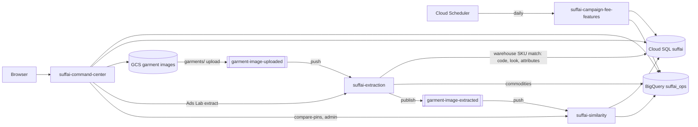

# One-command deploy (Cloud Shell or VS Code)

`deploy/deploy_all.sh` sets up and deploys the whole SuffAI stack on Google Cloud from a terminal. You never open the Console. All it needs is the ID of a project that exists. Nothing else has to be set up first: no APIs, buckets, service accounts, database or config file. It will:

- link billing if it's off
- enable the APIs
- create the service accounts and roles, and the buckets
- create the Cloud SQL database and run the SQL migrations
- create the BigQuery tables, load the seed data and run the BigQuery migrations
- create the Pub/Sub topics
- build the images, deploy the Cloud Run services and wire them together
- schedule the daily campaign-fee feature export.

Every step creates what is missing and leaves existing resources alone, so you can re-run it after every code change.

## Quick start

```bash
cd AI_CUP-main_Updated
./deploy/deploy_all.sh YOUR_PROJECT_ID --dry-run   # see every command it would run, change nothing
./deploy/deploy_all.sh YOUR_PROJECT_ID             # asks once, then runs everything (25-35 min the first time)
```

Use the project **ID** (for example `suffai-prod-123456`), not the display name. It's shown on the Console home page and in `gcloud projects list`.

At the end it prints the Command Center URL. Open `<url>/login.html` and sign in with a login from your offline `command_center_data/auth/login_creds_plaintext.csv` (it is never uploaded).

The first run spends a while on two things. The Cloud SQL instance takes about 10 minutes. New service accounts can take a minute or two before permissions on them take effect, so you'll see "Retrying in …" lines; that is expected.

**Billing.** If billing is already on, nothing happens. If it's off and your account can use exactly one billing account, that account is linked. With several, the script asks which one, or you can pass `--billing-account XXXXXX-XXXXXX-XXXXXX`.

**Region.** Everything goes to `asia-south1` unless you add `--region us-central1` (or another region).

**Without the ID on the command line**, the script uses `GOOGLE_CLOUD_PROJECT` (Cloud Shell sets this when you pick a project), then the `gcloud config` default project, and otherwise asks.

## Before you start

| | Cloud Shell | VS Code / local terminal |
|---|---|---|
| Google Cloud SDK (`gcloud`, `bq`) | Installed | [Install](https://cloud.google.com/sdk/docs/install) |
| Sign in | Automatic | `gcloud auth login`. The script opens the second sign-in it needs (`gcloud auth application-default login`) itself if missing |
| `psql` (migrations) | Installed | macOS: `brew install libpq && brew link --force libpq`; Linux: `apt install postgresql-client` |
| Python 3 | Installed | Python 3.9+ |
| Docker | Not needed | Not needed (images build on Cloud Build) |
| `cloud-sql-proxy` | Installed | Downloaded automatically to `~/.cache/suffai/` |

To get the code into Cloud Shell, either `git clone` the repo or use **Upload** in the Cloud Shell menu and unzip it.

Your account needs:

- **Owner** on the project.
- **Billing Account User** on a billing account, only if billing is off.

**Organization policies.** In projects under an organization, two policies can block this stack. The script checks them right after enabling the APIs:

- `iam.allowedPolicyMemberDomains` stops Command Center from being public. The script warns; the site then returns 403 until an org admin adds a project exception.
- `sql.restrictPublicIp` stops the Cloud SQL instance from being created. The script stops; ask an org admin for a project exception. Connections still go through IAM-authenticated connectors, never an open port.

## What it builds



| Area | Created |
|------|---------|
| Billing | Linked to the project if it was off |
| Cloud Run | `suffai-command-center` (public), `suffai-extraction` and `suffai-similarity` (private), `suffai-api` only if `DEPLOY_API=true` |
| Service accounts | One per service, `pubsub-push` for authenticated Pub/Sub pushes, and `suffai-build` for Cloud Build. Command Center may also sign as itself, which Style Assistant needs for image links |
| Cloud SQL | PostgreSQL instance `suffai-ops`, database `suffai`, user `suffai`, all migrations in `db/migrations` |
| Secret Manager | `suffai-db-password`, `suffai-database-url` (mounted as `DATABASE_URL`), `suffai-jwt-secret` (API only) |
| BigQuery | Dataset `suffai_ops` with customers, orders, commodities, login_cred_db, garment_similarity_observations, plus the `migrate_bq_*.sql` objects (garment_items view, pin_areas, ref_values, retail staff logins, catalog match and outfit tag columns, campaign fees); optional `suffai_raw` / `suffai_staging` / `suffai_marts` |
| Storage | `<project>-suffai-garment-images` (photos) and `<project>-cmd-center-raw` (CSV staging) |
| Pub/Sub | `garment-image-uploaded` and `garment-image-extracted`, each with a dead-letter topic (`-dlq`) and a pull subscription to inspect failures (`-dlq-pull`) |
| Artifact Registry | Docker repository `suffai` |
| Cloud Run Job + Scheduler | `suffai-campaign-fee-features` (Command Center image) run daily at 02:45 IST by `suffai-campaign-fee-features-daily`, as the `suffai-scheduler` account |

## Steps

Run all of them (default), pick some with `--only`, or leave some out with `--skip`. Names are comma-separated.

| Step | What it does |
|------|--------------|
| (always) | Links billing when it's off. Not selectable with `--only` |
| `apis` | Enables Cloud Run, Cloud Build, Artifact Registry, Cloud SQL Admin, Secret Manager, Pub/Sub, BigQuery, Storage, Vertex AI, Compute, IAM, Cloud Tasks, Cloud Scheduler and Logging. Creates the Google-managed service agents up front and checks the organization policies |
| `iam` | Creates the service accounts and grants each one only the roles it needs, including a build account that pushes images |
| `storage` | Creates both buckets (private, uniform access) and grants bucket access |
| `sql` | Creates the instance, database and user; stores the password and `DATABASE_URL` in Secret Manager |
| `migrate` | Opens a Cloud SQL Auth Proxy tunnel and applies every migration that has not been applied yet |
| `bigquery` | Creates the dataset and tables; loads the sample CSVs and role logins into empty tables; runs every `command_center/scripts/migrate_bq_*.sql`; recomputes RFM segments when there are customers (PIN areas too if `BACKFILL_PIN_AREAS=true`) |
| `pubsub` | Creates topics, dead-letter topics and publish permissions; the bucket notification that sends `garments/` uploads to extraction |
| `build` | Builds all images in one Cloud Build run (or local Docker), tagged with a timestamp. Stops if `.gcloudignore` would upload private files |
| `deploy` | Deploys similarity, extraction (with the visual catalog match settings), (API), then Command Center (one instance, CPU always on, 1P fee settings) with the right env vars, secrets and Cloud SQL attachment |
| `wire` | Gives Command Center and Pub/Sub permission to call the private services, creates the push subscriptions, removes the old similarity subscription on the upload topic |
| `jobs` | Creates or updates the `suffai-campaign-fee-features` Cloud Run Job and its daily Cloud Scheduler trigger (skipped when `ENABLE_FEE_FEATURES_JOB=false`) |
| `verify` | Calls Command Center `/health`, shows the push endpoints, the fee job schedule and the URLs |

Common runs:

```bash
./deploy/deploy_all.sh MY_PROJECT --only build,deploy          # ship a code change
./deploy/deploy_all.sh MY_PROJECT --only migrate               # apply a new db/migrations file
./deploy/deploy_all.sh MY_PROJECT --only migrate,build,deploy,jobs   # this release: 016 + visual catalog match + fee job
./deploy/deploy_all.sh MY_PROJECT --only deploy --yes          # redeploy the last built images, no prompt
IMAGE_TAG=20261023-1530 ./deploy/deploy_all.sh MY_PROJECT --only deploy   # roll back to an earlier build
```

## Settings (optional)

You don't need to set anything: every setting has a default, and all names (buckets, database, topics, service accounts) are derived from the project ID. To change a default, either export the variable before running, or copy `deploy/deploy.env.example` to `deploy/deploy.env` (gitignored), edit it and pass `--env-file deploy/deploy.env`. Exported variables win over the file, and command-line options win over both.

| Setting | Default | Notes |
|---------|---------|-------|
| `GOOGLE_CLOUD_PROJECT` | argument | Normally given as the first argument |
| `GCP_REGION` | `asia-south1` | Region for every resource (`--region`) |
| `BILLING_ACCOUNT` | auto | Linked only when billing is off (`--billing-account`) |
| `CREATE_PROJECT` | `false` | `true` also creates the project if it doesn't exist (with `ORG_ID` or `FOLDER_ID` as parent) |
| `BUILD_MODE` | `cloudbuild` | `docker` builds locally (needs Docker; builds `linux/amd64`) |
| `SQL_TIER` | `db-g1-small` | Use `db-custom-1-3840` or larger for production |
| `DB_PASSWORD` | empty | Generated on first run. Set it only to adopt an existing database user |
| `LOAD_SAMPLE_DATA` / `FORCE_SAMPLE_DATA` | `true` / `false` | Sample CSVs only go into empty tables unless forced |
| `LOAD_LOGINS` / `FORCE_LOGINS` | `true` / `false` | Same rule for `login_cred_db` |
| `ENABLE_VERTEX` | `true` | Gemini extraction, image fingerprints and AURA chat |
| `DEPLOY_API` | `false` | Legacy FastAPI (customer upload initiate/complete) |
| `ENABLE_GCS_NOTIFICATION` | `true` | Customer photos uploaded to `gs://<bucket>/garments/<customer_id>_<order_id>_<item_id>.jpg` trigger extraction. Turn off only when uploads go through the legacy API |
| `GEO_CITY` | `Bengaluru` | City used to name PIN areas (Geo, Admin) |
| `BACKFILL_PIN_AREAS` | `false` | Look up every customer PIN with Gemini during the `bigquery` step |
| `ENABLE_CLOUD_TASKS` | `false` | Run Ads Lab ranking jobs on Cloud Tasks (runs `deploy/setup_cloud_tasks.sh`) |
| `REFRESH_METRICS` | `false` | Rebuild `web/metrics.json` from BigQuery before building |
| `CATALOG_MATCH_THRESHOLD` | `0.92` | A customer photo takes a warehouse style's details (size stays from the photo) only when exactly one catalog style × colour photo is this similar |
| `CATALOG_EMBED_PER_REQUEST` | `40` | Catalog photos fingerprinted per customer photo until the brand's catalog is done (stored in Cloud SQL, redone when a photo is replaced) |
| `FEE_*` | see example | 1P platform-fee cost policy on Command Center (`FEE_VERTEX_SHADOW=false` until real accepted fees exist) |
| `ENABLE_FEE_FEATURES_JOB` / `FEE_FEATURES_SCHEDULE` | `true` / `45 2 * * *` | Daily aggregate fee export (`SCHEDULER_TIME_ZONE`, default `Asia/Kolkata`) |

See `deploy/deploy.env.example` for the full list (models, thresholds, topic names).

## How the migrations are tracked

The script keeps a `schema_migrations` table in Cloud SQL and applies each file in `db/migrations` once, in order, inside a transaction. Add a new numbered file and run `--only migrate`.

On a database that was migrated by hand before this script, the first run checks which migrations are already in place (by looking for the tables and columns each one creates, through 016) and records them, so nothing is re-applied. Re-running old migrations is not safe here: 006 and 008 narrow the campaign status check and would fail on newer rows.

The BigQuery migrations (`migrate_bq_*.sql`) are all safe to re-run, so the `bigquery` step runs every one of them each time.

## Upgrading an existing deployment

The first run against a project that already has the services changes a few things. All are one-off.

- **Service accounts.** The services move from the default compute account to their own accounts (`suffai-command-center@…` and so on), with the roles listed above.
- **`DATABASE_URL` moves to Secret Manager.** If a service has it as a plain env var, the script removes it and mounts the secret instead. This creates one revision without a database just before the new one is deployed. Put your existing password in `DB_PASSWORD` (and `SQL_INSTANCE`, `SQL_DATABASE`, `SQL_USER` if they differ), so the secret points at the same database.
- **Pub/Sub.** Extraction's subscription is `garment-image-uploaded-push` and similarity's is `garment-image-extracted-similarity-push`, both with dead-letter topics. The old `garment-image-uploaded-similarity-push` is deleted. If other subscriptions on the upload topic exist, the script warns but leaves them.
- **Existing data.** BigQuery tables with rows and the login table are left as they are (the login table can hold warehouse and store staff created in the app).

## Checking the result

```bash
CC=$(gcloud run services describe suffai-command-center --region=asia-south1 --format='value(status.url)')
curl -s "$CC/health" | python3 -m json.tool        # use_bq, database_url, extraction_url, similarity_url should be true
gcloud run services logs read suffai-extraction --region=asia-south1 --limit=50
gcloud pubsub subscriptions pull garment-image-uploaded-dlq-pull --limit=5   # photos that failed 5 times
```

Then sign in as admin, a brand and a customer, and walk through Geo, Ads Lab (upload a few SKU photos and rank them), Campaigns and Style Assistant.

## Troubleshooting

| Symptom | Fix |
|---------|-----|
| `… is not a project ID` | You passed the display name. Use the ID from `gcloud projects list` |
| `Project … not found` | Check the ID, and that `gcloud config get-value account` is an account with access to it |
| `Billing is not enabled … Pick one of these billing accounts` | Re-run with `--billing-account ID` |
| `Billing is not enabled … can't use any billing account` | Ask a billing admin to link one to the project (or grant you Billing Account User) |
| `Could not pre-create the … service agent` | Harmless warning outside Cloud Shell (the gcloud beta component is missing); later permission changes retry until the agent exists. Or run `gcloud components install beta` |
| `Application Default Credentials missing` | `gcloud auth application-default login` (local terminal only) |
| `psql not found` | Install the PostgreSQL client (see the table above), or run in Cloud Shell |
| `User suffai already exists but its password is unknown` | Set `DB_PASSWORD`, or `RESET_DB_PASSWORD=true` to reset it (other clients using the old password will break) |
| `cloud-sql-proxy exited` | See the log path it prints; usually the Cloud SQL Admin API is still enabling or the account lacks `cloudsql.client` |
| Cloud Build: permission denied on Artifact Registry or logs | Re-run `--only iam,build`; the `suffai-build` account gets the writer and log roles |
| Command Center returns 403 on every page | `iam.allowedPolicyMemberDomains` blocked the public binding. Ask an org admin for an exception, then re-run `--only deploy` |
| Vertex errors in extraction or similarity logs | The model is not available in `VERTEX_LOCATION`; set `VERTEX_LOCATION=us-central1` and re-run `--only deploy` |
| Every photo processed twice | Two publishers: the legacy API and the bucket notification, or two bucket notifications. Keep one |
| Customer photo uploaded but no item appears | Its order is missing or belongs to another customer (extraction logs `unlinked photo`). Create the order in Admin, then upload the photo again |

## Known limits

- **Customer signed-URL upload in `suffai-api`.** `garment_images.py` signs URLs without a private key, which Cloud Run does not have, so `images:initiate` returns 503 there. Ads Lab and Command Center uploads are not affected.
- **Terraform.** `infra/terraform` describes an older layout (including `suffai-web`). Use either Terraform or this script for a project, not both.
- **Teardown.** Not automated, on purpose. Delete the Cloud Run services, the Cloud SQL instance, the buckets and the `suffai_*` datasets by hand if you want to remove everything.

## Related

- [GCP_REDEPLOY_E2E.md](GCP_REDEPLOY_E2E.md): manual step-by-step redeploy and release notes
- `deploy/bootstrap_new_project.sh`: the older single-pass bootstrap; `deploy_all.sh` covers the same ground and can be re-run step by step
- [GCP_COMMAND_CENTER.md](GCP_COMMAND_CENTER.md): Command Center APIs and layout
