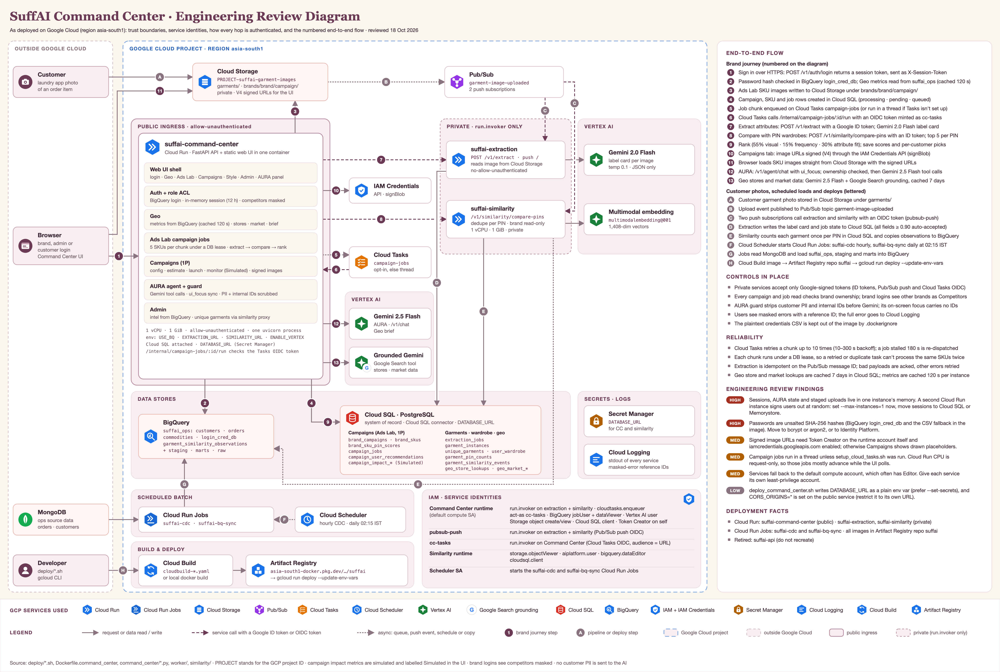
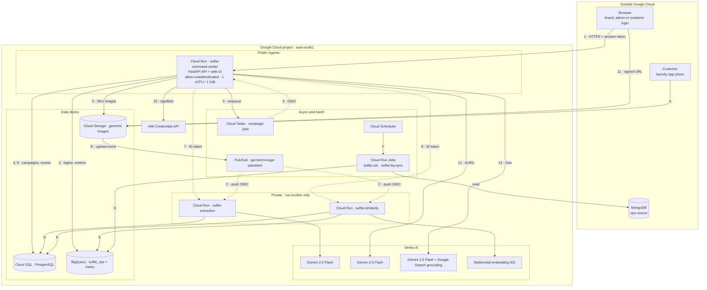
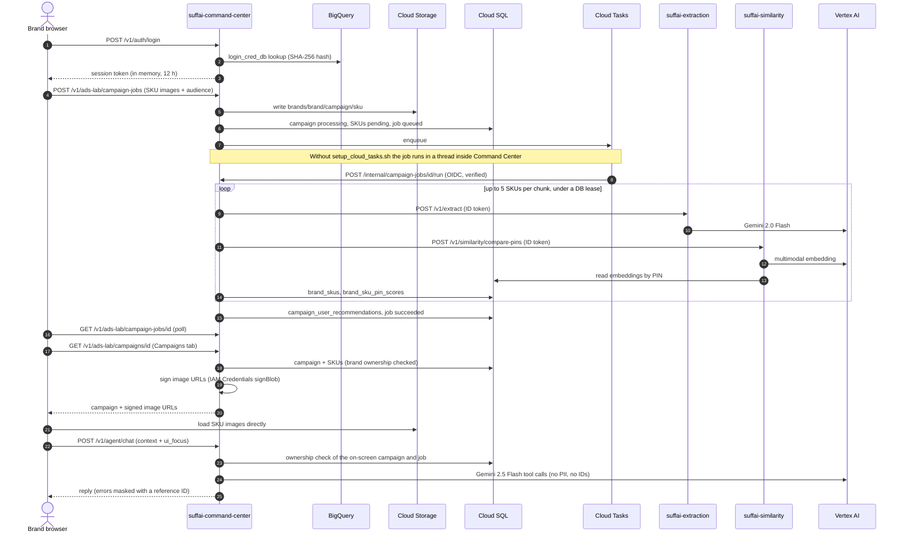

# SuffAI Command Center: Engineering Review

| | |
|---|---|
| **Document** | Engineering Review Diagram (ERD) and design review |
| **System** | SuffAI Command Center on Google Cloud |
| **Region** | `asia-south1` (Gemini with Google Search grounding runs in `global`) |
| **Version** | 1.0, 18 Oct 2026 |
| **Status** | Draft for review |
| **Sources** | `deploy/*.sh`, `Dockerfile.*`, `command_center/`, `worker/`, `similarity/` |

`PROJECT` stands for the Google Cloud project ID throughout.

---

## 1. Summary

SuffAI Command Center gives fashion brands PIN-level insight from laundry data. Brands use it to find where to open stores, rank their SKU images against what people in each PIN actually wear, and plan first-party (1P) campaigns. An AI assistant, AURA, can run any of these tasks from chat.

On Google Cloud it runs as:

- **Three Cloud Run services:**
  - `suffai-command-center` is public. It serves both the API and the web UI.
  - `suffai-extraction` is private. It reads garment attributes from images with Gemini.
  - `suffai-similarity` is private. It matches garments with Vertex AI embeddings.
- **Two Cloud Run Jobs** (`suffai-cdc`, `suffai-bq-sync`), started by Cloud Scheduler, load operational data into BigQuery.
- **Event-driven work:**
  - Pub/Sub carries customer photo uploads to both private services.
  - Cloud Tasks (optional) runs Ads Lab ranking jobs in chunks.
- **Data split by purpose:**
  - Cloud SQL holds transactional state.
  - BigQuery holds analytics and logins.
  - Cloud Storage holds images.

The review found seven issues, two of them high severity (section 11):

- Sessions live in a single instance's memory.
- Password hashes are unsalted SHA-256.

---

## 2. Engineering Review Diagram

Vector and print versions: [SVG](assets/suffai_engineering_review.svg) · [PDF](assets/suffai_engineering_review.pdf)

**How to read it:**

- **Boundaries:** a blue dashed line marks the Google Cloud project. A grey dashed box holds everything outside it: browsers, the customer app, MongoDB and the developer.
- **Zones inside the project:**
  - Public ingress holds Command Center.
  - The private zone holds extraction and similarity, which only accept callers with `run.invoker`.
  - The rest are Vertex AI, data stores, secrets and logs, scheduled batch, and build and deploy.
- **Line styles:**
  - Solid lines are requests and data reads or writes.
  - Dashed plum lines are service calls carrying a Google ID token or OIDC token.
  - Dotted lines are asynchronous: queues, push events, schedules and copies.
- **Badges:**
  - Numbered badges 1–13 follow the brand journey (section 5.1).
  - Lettered badges A–H cover the customer photo pipeline, scheduled loads and deployment (sections 5.2–5.4).

### 2.1 Topology

GitHub renders this version directly, so it's readable even without the image.

### 2.2 Brand journey, hop by hop

---

## 3. Deployed components

| Component | Google Cloud service | Name | Access |
|---|---|---|---|
| Command Center API + web UI | Cloud Run service | `suffai-command-center` | Public (`--allow-unauthenticated`); app-level session token |
| Attribute extraction | Cloud Run service | `suffai-extraction` | Private (`--no-allow-unauthenticated`) |
| Garment similarity | Cloud Run service | `suffai-similarity` | Private (`--no-allow-unauthenticated`) |
| Incremental ingest | Cloud Run Job | `suffai-cdc` | Started by Cloud Scheduler, hourly |
| Warehouse rebuild | Cloud Run Job | `suffai-bq-sync` | Started by Cloud Scheduler, daily 02:15 IST |
| Photo upload events | Pub/Sub | topic `garment-image-uploaded`; subscriptions `garment-image-uploaded-push`, `garment-image-uploaded-similarity-push` | Push with OIDC as `pubsub-push` |
| Ranking job queue (optional) | Cloud Tasks | queue `campaign-jobs` | OIDC as `cc-tasks` |
| Transactional store | Cloud SQL for PostgreSQL | instance in `CLOUD_SQL_INSTANCE` | Cloud SQL connector, `DATABASE_URL` |
| Analytics and logins | BigQuery | `suffai_ops`, `suffai_staging`, `suffai_marts`, `suffai_raw` | Runtime service accounts |
| Images | Cloud Storage | `PROJECT-suffai-garment-images` | Private; V4 signed URLs for the browser |
| Garment attributes | Vertex AI | Gemini 2.0 Flash | Called by extraction |
| AURA, chat, Geo brief | Vertex AI | Gemini 2.5 Flash | Called by Command Center |
| Store and market lookups | Vertex AI + Google Search grounding | Gemini 2.5 Flash, location `global` | Called by Command Center |
| Garment vectors | Vertex AI | `multimodalembedding@001` (1,408 dimensions) | Called by similarity |
| URL signing | IAM Credentials API | `signBlob` | Command Center runtime account |
| Secrets | Secret Manager | `DATABASE_URL` | Mapped into Command Center and similarity |
| Logs | Cloud Logging | stdout of every service | Masked-error reference IDs |
| Images registry | Artifact Registry | repo `suffai` in `asia-south1` | Pulled by Cloud Run at deploy |
| Builds | Cloud Build | `deploy/cloudbuild-*.yaml` | Or a local `docker build` |

`suffai-api` is retired and should not be recreated.

---

## 4. Trust boundaries and authentication

| Hop | Protocol | How it's authenticated |
|---|---|---|
| Browser → Command Center | HTTPS | Session token from `POST /v1/auth/login`, sent as `X-Session-Token`; valid 12 h; role ACL on every route |
| Browser → Cloud Storage | HTTPS | Time-limited V4 signed URL issued by Command Center |
| Command Center → extraction, similarity | HTTPS | Google ID token (audience = service URL); caller needs `run.invoker` |
| Pub/Sub → extraction, similarity | HTTPS push | OIDC token as `pubsub-push`; `run.invoker` on both services |
| Cloud Tasks → Command Center | HTTPS | OIDC token as `cc-tasks`; verified in code before `/internal/campaign-jobs/{id}/run` runs |
| Command Center, similarity → Cloud SQL | Cloud SQL connector (Unix socket) | `cloudsql.client` + `DATABASE_URL` credentials |
| Services → BigQuery, Cloud Storage, Vertex AI | Google APIs | Runtime service account (Application Default Credentials) |
| Cloud Scheduler → Cloud Run Jobs | Google APIs | OAuth as the scheduler service account |

---

## 5. End-to-end flows

### 5.1 Brand journey (numbered 1–13 on the diagram)

1. **Sign in.** The browser posts to `/v1/auth/login` and gets a session token, which it sends as `X-Session-Token` on every request.
2. **Check login and load Geo.** The password hash is checked against BigQuery `suffai_ops.login_cred_db`. The Geo tab's metrics come from `suffai_ops`, cached for 120 s per instance. Brand logins see other brands as "Competitors".
3. **Upload SKUs.** Ads Lab writes the brand's SKU images to Cloud Storage under `brands/{brand}/{campaign}/`.
4. **Create the job.** Command Center creates the campaign, SKU and job rows in Cloud SQL (statuses processing, pending and queued).
5. **Queue the work.** One job chunk is put on the Cloud Tasks queue `campaign-jobs`. If Cloud Tasks isn't set up, the job runs in a background thread inside Command Center instead.
6. **Run a chunk.** Cloud Tasks calls `/internal/campaign-jobs/{id}/run` with an OIDC token minted as `cc-tasks`. Each call processes up to 5 pending SKUs under a database lease.
7. **Extract attributes.** For each SKU, Command Center calls extraction `POST /v1/extract` with a Google ID token. Gemini 2.0 Flash returns a label card: type, material, colour, pattern, size and brand, each with a confidence score.
8. **Compare with wardrobes.** Command Center calls similarity `POST /v1/similarity/compare-pins` with an ID token. Similarity embeds the SKU and returns the top 5 matching garments per PIN. It never writes customer data on this path.
9. **Rank and save.** The score is `100 × (0.55 × visual match + 0.15 × frequency coverage + 0.30 × attribute fit)`. Scores go to `brand_skus` and `brand_sku_pin_scores`, and per-customer picks go to `campaign_user_recommendations`. The job is then marked succeeded.
10. **Sign image URLs.** When the Campaigns tab opens a campaign (by default the brand's newest), Command Center signs each image URL (V4) through the IAM Credentials API.
11. **Show images.** The browser loads the SKU images straight from Cloud Storage with those signed URLs.
12. **AURA.** The browser posts to `/v1/agent/chat` with the tab context and `ui_focus`, which names the campaign and ranking job on screen. Command Center checks that the brand owns them, then runs Gemini 2.5 Flash tool calls. Customer PII and internal IDs are removed before anything reaches the model.
13. **Geo stores and market data.** Store and market lookups use Gemini 2.5 Flash with Google Search grounding. Results are cached for 7 days in Cloud SQL (`geo_store_lookups`, `geo_market_enrichment`).

### 5.2 Customer photo pipeline (A–E)

- **A.** A customer garment photo is stored in Cloud Storage under `garments/`.
- **B.** The bucket publishes an upload event to Pub/Sub `garment-image-uploaded`. Both services parse the Cloud Storage notification format.
- **C.** Two push subscriptions call extraction and similarity at the same time, each with an OIDC token as `pubsub-push`.
- **D.** Extraction writes the label card and job state to Cloud SQL (`extraction_jobs`, `garment_instances`).
  - If every attribute's confidence is at least 0.90, the card is accepted automatically.
  - Otherwise it's marked for review.
- **E.** Similarity counts each real garment once per PIN in Cloud SQL (`unique_garments`, `user_wardrobe`, `garment_pin_counts`, `garment_similarity_events`). Two embeddings count as the same garment at a cosine similarity of 0.92 or higher. It also copies each outcome to BigQuery `garment_similarity_observations`.

### 5.3 Scheduled data loads (F–G)

- **F.** Cloud Scheduler starts `suffai-cdc` every hour and `suffai-bq-sync` daily at 02:15 IST.
- **G.** The jobs read MongoDB and load `suffai_ops`, staging and marts into BigQuery.

### 5.4 Build and deploy (H)

- **H.** A Cloud Build or local Docker image is pushed to Artifact Registry repo `suffai`, then deployed with `gcloud run deploy ... --update-env-vars`. That flag keeps existing settings such as `DATABASE_URL`, the Cloud SQL attachment and the Cloud Tasks variables.

---

## 6. Service identities and IAM

| Identity | Roles it needs |
|---|---|
| **Command Center runtime** (the default compute account unless one is set) | `run.invoker` on extraction and similarity; `cloudtasks.enqueuer` on `campaign-jobs`; `iam.serviceAccountUser` on `cc-tasks`; BigQuery Job User + Data Viewer on `suffai_ops`; Storage object create and view on the image bucket; Vertex AI User; Cloud SQL Client; Service Account Token Creator **on itself** (for signed URLs) |
| `pubsub-push` | `run.invoker` on extraction and similarity |
| `cc-tasks` | `run.invoker` on Command Center |
| **Similarity runtime** | `storage.objectViewer`, `aiplatform.user`, `bigquery.dataEditor`, `cloudsql.client` |
| **Scheduler account** | Permission to run the two Cloud Run Jobs (`run.developer` or Job Invoker) |
| Pub/Sub service agent | `iam.serviceAccountTokenCreator`, so it can mint push tokens |

**APIs the deployment depends on:** Cloud Run, Cloud SQL Admin, BigQuery, Cloud Storage, Pub/Sub, Cloud Tasks, Cloud Scheduler, Vertex AI, IAM Credentials, Secret Manager, Artifact Registry and Cloud Build.

---

## 7. Data stores and data handling

| Store | What it holds | Sensitivity | Who reads it |
|---|---|---|---|
| BigQuery `suffai_ops` | `customers`, `orders`, `commodities`, `login_cred_db`, `garment_similarity_observations` | Personal data (customer names and phone numbers); password hashes | Command Center: logins, aggregated metrics for brands, admin intel |
| BigQuery staging, marts, raw | Star schema and run history | Aggregated | Analytics |
| Cloud SQL | Campaigns, SKUs, scores, jobs, per-customer recommendations, garments, wardrobes, geo caches | Pseudonymous customer IDs; brand data | Command Center, extraction, similarity |
| Cloud Storage | `garments/` customer photos, `brands/` SKU images | Customer photos are personal | Services directly; browsers only through signed URLs |
| Command Center memory | Sessions, AURA state, AURA staged uploads (up to 10 images, 5 MB each, 30 min) | Session tokens; brand images | That one instance only |

**Privacy rules the code enforces:**

- Brands see PIN-level aggregates only, with other brands masked as "Competitors".
- No customer PII is sent to Gemini.
- Images uploaded to AURA have their metadata stripped.
- Campaign impact metrics are simulated, and the UI labels them "Simulated".

---

## 8. Security and privacy controls in place

- **Private services:** extraction and similarity accept only Google-signed tokens (ID tokens, Pub/Sub push OIDC and Cloud Tasks OIDC).
- **Internal route:** `/internal/campaign-jobs/{id}/run` verifies the Cloud Tasks OIDC token itself.
- **Ownership checks:** every campaign and job read checks that the signed-in brand owns it, including the campaign and job AURA receives from the screen.
- **AURA guard:** strips customer PII and internal keys such as `campaign_id` and `job_id` from everything sent to Gemini. AURA errors shown to users are masked.
- **Masked errors:** users see a generic message with a reference ID, and the full error is logged to Cloud Logging.
- **Admin phone reveal:** admin-only, logged, and sent with `no-store`.
- **Credentials file:** `.dockerignore` keeps the plaintext credentials CSV (`command_center_data/auth/login_creds_plaintext.csv`) out of the image. Keep that file out of Git as well.

---

## 9. Reliability, scaling and performance

- **Cloud Tasks retries:** a failed chunk is retried up to 10 times, with a 10–300 s backoff.
- **Stalled jobs:** a job stalled for 180 s is re-dispatched the next time the UI polls it.
- **Database lease:** each chunk runs under a lease, so a retried or duplicate task can't process the same SKUs twice.
- **Extraction and Pub/Sub:**
  - Extraction is idempotent on the Pub/Sub message ID.
  - Bad payloads are acknowledged with HTTP 200, so they aren't retried.
  - Other errors return 500, so Pub/Sub retries them.
- **Similarity** skips images it has already processed.
- **Caches:** metrics are cached for 120 s per instance, admin intel for 600 s, and Geo store and market lookups for 7 days in Cloud SQL.
- **Sizing:** Command Center and similarity each run with 1 vCPU and 1 GiB. Command Center runs a single uvicorn process per instance.
- **Scaling limit:** sessions and AURA state are held in memory, so Command Center can't safely run more than one instance (finding F1).

---

## 10. Key configuration

| Variable | Service | Purpose |
|---|---|---|
| `USE_BQ`, `BQ_DATASET` | Command Center, similarity | Read from BigQuery `suffai_ops` |
| `DATABASE_URL`, `CLOUD_SQL_INSTANCE` | Command Center, similarity, extraction | Cloud SQL connection |
| `GCS_IMAGE_BUCKET` | All three services | Shared image bucket |
| `EXTRACTION_URL`, `SIMILARITY_URL` | Command Center | Private service URLs (also the ID-token audiences) |
| `ENABLE_VERTEX`, `VERTEX_LOCATION`, `VERTEX_CHAT_MODEL` | Command Center | Gemini 2.5 Flash in `asia-south1` |
| `GEO_GROUNDING_MODEL`, `GEO_GROUNDING_LOCATION` | Command Center | Grounded Gemini in `global` |
| `VERTEX_MODEL`, `AUTO_ACCEPT_CONFIDENCE` | Extraction | Gemini 2.0 Flash; 0.90 auto-accept |
| `VERTEX_EMBED_MODEL`, `SIMILARITY_THRESHOLD` | Similarity | `multimodalembedding@001`; 0.92 match |
| `COMMAND_CENTER_URL`, `CLOUD_TASKS_QUEUE`, `TASKS_SERVICE_ACCOUNT` | Command Center | Cloud Tasks mode (unset = thread mode) |
| `CAMPAIGN_JOB_CHUNK`, `CAMPAIGN_JOB_STALE_SEC` | Command Center | 5 SKUs per chunk; re-dispatch after 180 s |
| `AUTH_SOURCE`, `AUTH_SESSION_TTL_SEC` | Command Center | Login source (BigQuery, then CSV); 12 h sessions |
| `CORS_ORIGINS` | Command Center, similarity | Currently `*` |

---

## 11. Review findings

| ID | Severity | Finding | Evidence | Recommendation |
|---|---|---|---|---|
| F1 | **High** | Sessions, AURA state and AURA staged uploads live in one instance's memory. When Cloud Run starts a second instance, users are signed out at random and AURA loses its context. | `_SESSIONS` in `command_center/auth_acl.py`; `_state_for` in `command_center/aura_agent.py`; no `--max-instances` in `deploy/deploy_command_center.sh` | Now: deploy with `--max-instances=1`. Then: store sessions and AURA state in Cloud SQL or Memorystore. |
| F2 | **High** | Passwords are stored as unsalted SHA-256 hashes, which are fast to brute-force. | `sha256_hex` in `command_center/auth_acl.py`; BigQuery `login_cred_db`; `login_cred_db.csv` is copied into the image as a fallback | Move to bcrypt or argon2, or to Identity Platform (the target architecture). Drop the CSV fallback in production. |
| F3 | Medium | Signed image URLs need Token Creator on the runtime account itself and `iamcredentials.googleapis.com` enabled. Without both, Campaigns and AURA show drawn placeholders instead of the real images. | `generate_signed_url(... service_account_email=...)` in `command_center/style_assistant.py`; no deploy script grants either | Add both to `deploy/deploy_command_center.sh`. |
| F4 | Medium | Campaign jobs run in a background thread unless `setup_cloud_tasks.sh` has been run. Cloud Run only gives a service CPU while it handles requests, so those jobs mostly advance while the UI polls. | `deploy/setup_cloud_tasks.sh` is opt-in; thread fallback in `command_center/campaign_jobs.py` | Run `setup_cloud_tasks.sh` in production, or deploy with `--no-cpu-throttling`. |
| F5 | Medium | Services fall back to the default compute account, which often has the broad Editor role. | No `--service-account` in the deploy scripts; fallback in `deploy/setup_cloud_tasks.sh` | Create one least-privilege account per service with the roles in section 6. |
| F6 | Low | The deploy script can write `DATABASE_URL` as a plain env var, and `CORS_ORIGINS=*` is set on the public service. | `deploy/deploy_command_center.sh` | Map `DATABASE_URL` with `--set-secrets`. Restrict CORS to the Command Center URL. |
| F7 | Low | The admin phone-reveal endpoint is still live, although no page calls it any more. | `POST /v1/admin/intel/customers/{id}/reveal-phone` in `command_center/main.py`; no caller in `web/` | Remove it, or keep it behind a break-glass flag. It's already admin-only and logged. |

---

## 12. Deploy and rollback

- **Order:**
  1. Apply any Cloud SQL migrations.
  2. Deploy similarity if it changed.
  3. Deploy Command Center (`deploy/deploy_command_center.sh`).
  4. Run `deploy/setup_cloud_tasks.sh` once.
  5. Verify with `/health` and a sign-in.
- **Command Center rollback:** `gcloud run services update-traffic suffai-command-center --to-revisions=PREVIOUS_REVISION=100`
- **Cloud Tasks rollback:** `gcloud run services update suffai-command-center --remove-env-vars=CLOUD_TASKS_QUEUE` returns to thread mode.
- **Guides:** one-command deploy in [DEPLOY_ALL.md](DEPLOY_ALL.md); step-by-step instructions in [GCP_REDEPLOY_E2E.md](GCP_REDEPLOY_E2E.md).

---

## 13. Assumptions and open questions

1. **Cloud Tasks:** is it enabled in production, or are jobs still in thread mode? Check with `gcloud run services describe suffai-command-center` and look for `CLOUD_TASKS_QUEUE`.
2. **Runtime accounts:** which service accounts do the three services run as? The repo doesn't set them, and the roles for extraction's runtime account aren't documented.
3. **Instance limits:** what minimum and maximum instance counts are set on Command Center in production? This decides how urgent F1 is.
4. **Secrets:** is `DATABASE_URL` mapped from Secret Manager on the live services, or set as a plain value?
5. **Upload events:** the Cloud Storage notification that publishes `garment-image-uploaded` isn't created by any script in this repo. It's assumed to be configured on the bucket.
6. **Diagram scope:** the diagram shows the production design. Locally, Command Center can run without Cloud SQL, BigQuery or Vertex AI (APIs return masked 503s).

---

## 14. References

- Deploy scripts: [`deploy/deploy_command_center.sh`](../deploy/deploy_command_center.sh), [`deploy/deploy_similarity.sh`](../deploy/deploy_similarity.sh), [`deploy/deploy_cloud_run.sh`](../deploy/deploy_cloud_run.sh), [`deploy/setup_cloud_tasks.sh`](../deploy/setup_cloud_tasks.sh), [`deploy/scheduler.yaml`](../deploy/scheduler.yaml)
- Images: [`Dockerfile.command_center`](../Dockerfile.command_center), [`.dockerignore`](../.dockerignore)
- Code: [`command_center/main.py`](../command_center/main.py), [`auth_acl.py`](../command_center/auth_acl.py), [`aura_agent.py`](../command_center/aura_agent.py), [`aura_guard.py`](../command_center/aura_guard.py), [`campaign_jobs.py`](../command_center/campaign_jobs.py), [`style_assistant.py`](../command_center/style_assistant.py), [`worker/main.py`](../worker/main.py), [`similarity/main.py`](../similarity/main.py)
