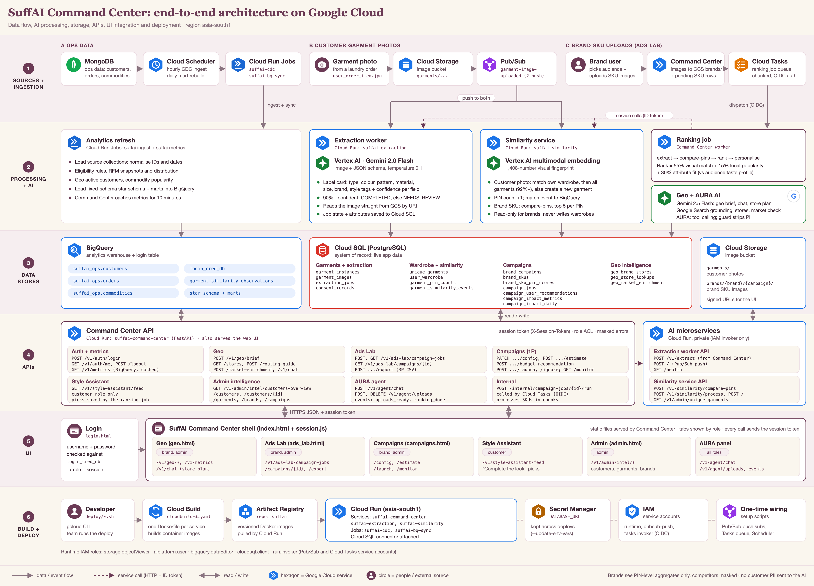
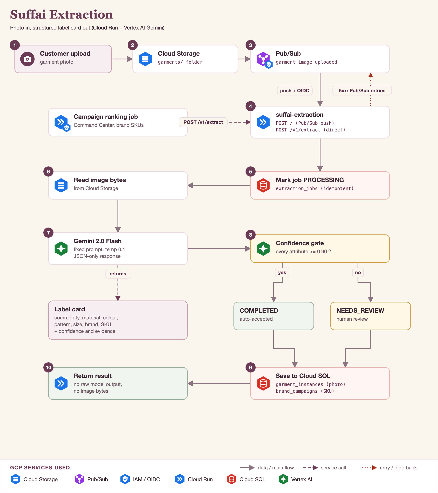
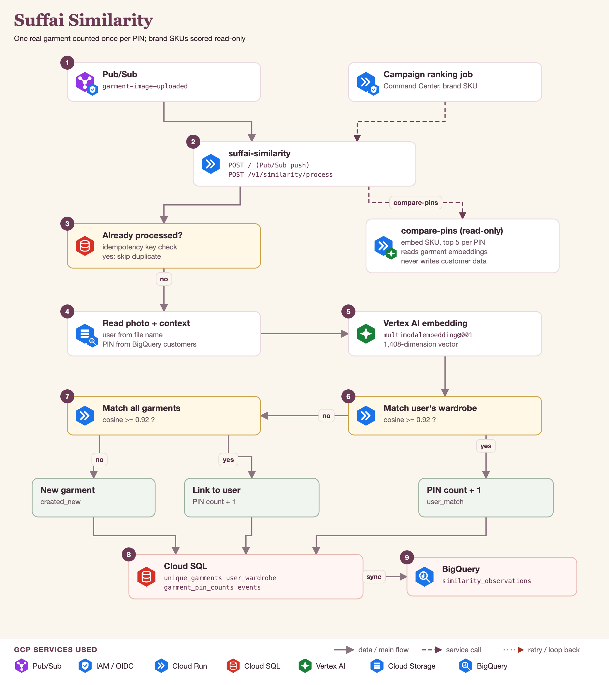
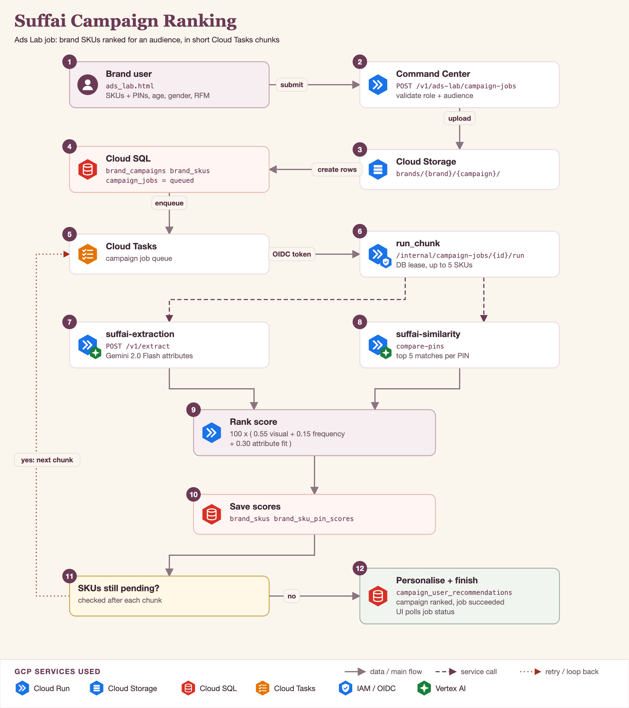
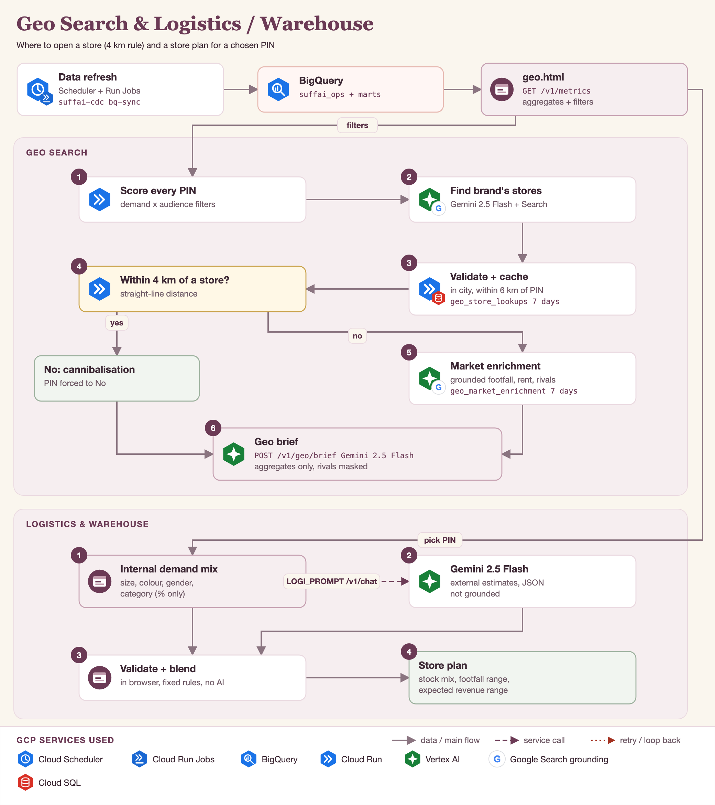

# Product Requirements Document: SuffAI Command Center

| | |
|---|---|
| **Product** | SuffAI Command Center: wardrobe intelligence for fashion brands |
| **Document owner** | Senior Product Manager, SuffAI |
| **Status** | Draft v2.0, for leadership review |
| **Last updated** | 18 Oct 2026 |
| **Approvers** | Head of Product, Head of Engineering, Head of Data/ML, Privacy & Legal, Head of Brand Partnerships |
| **Related docs** | [Project overview](SUFFAI_PROJECT_OVERVIEW.md) · [Feature extraction guide](FEATURE_EXTRACTION_GUIDE.html) · [Architecture diagram](assets/suffai_architecture.png) · [Redeploy guide](GCP_REDEPLOY_E2E.md) |

### Change log
| Version | Date | Change |
|---|---|---|
| 1.0 | 18 Oct 2026 | First full PRD written from the current build |
| 2.0 | 18 Oct 2026 | Added strategy, competition, North Star and metric tree, jobs-to-be-done, user stories with acceptance criteria, prioritisation, AI evaluation plan, pricing, pilot and launch plan, launch readiness, RACI |

### TL;DR
- **What:** an AI product that turns SuffAI's laundry garment photos into privacy-safe, PIN-level wardrobe intelligence. Brands use it to decide **where** to open or stock stores, **which** products to promote, and **whom** to target. Customers get **personal picks** that match their own wardrobe.
- **Why us:** SuffAI physically sees what people own, at scale, with consent and the location of each order. No ad platform, survey panel or footfall vendor has that signal.
- **Where we are:** the end-to-end product is **built** on Google Cloud (milestones M1–M3). Campaign delivery and performance figures are **Simulated** in this release.
- **What's next:** harden the product for a **5-brand, 8-week paid pilot** (M4), then add real message delivery and measurement (M5).
- **Decisions needed from approvers:** pilot targets (§7), pricing hypotheses (§17), the minimum group size for brand views (Q2), and the consent wording (Q1).

---

## 1. Executive summary

SuffAI runs a laundry service. Every order produces photos of the garments customers send. Together these photos are a continuously refreshed record of **what people in each PIN code actually own and wear**: garment types, colours, patterns, materials, sizes and brands.

The **SuffAI Command Center** turns those photos into privacy-safe insight for fashion brands. It has four connected capabilities:

1. **Geo Intelligence:** where to open a store, or how to stock existing ones.
2. **Ads Lab:** which of the brand's products fit a chosen audience, ranked from 0 to 100.
3. **Campaigns (1P):** activate the ranked products on SuffAI's own channels (in-app, WhatsApp, SMS), or export them to other platforms (3P).
4. **Style Assistant:** customers get personal picks that complete outfits they already own.

An **Admin** console gives the SuffAI team oversight of customers, garments, brands and campaigns. An AI agent, **AURA**, runs on every page and answers questions or carries out tasks.

The product runs entirely on Google Cloud: Cloud Run, Vertex AI (Gemini and multimodal embeddings), Cloud SQL, BigQuery, Cloud Storage, Pub/Sub, Cloud Tasks and Cloud Scheduler.

---

## 2. Background and strategic fit

### 2.1 Why SuffAI should build this
| Strategic pillar | How the Command Center supports it |
|---|---|
| **New revenue beyond laundry** | It sells insight and activation to brands, earning B2B revenue from data SuffAI already collects |
| **Customer engagement** | Style Assistant gives customers a reason to open the app between orders |
| **Data moat** | Each laundry order improves the wardrobe graph, and competitors can't copy that signal |
| **Trust as a differentiator** | Privacy is designed in: aggregate-only access for brands, no personal data sent to AI, masked competitors |

### 2.2 Why now
- **Multimodal AI is now cheap and accurate enough** to read garment attributes and compare images at laundry scale. On Vertex AI that means Gemini Flash and multimodal embeddings.
- **Brands are short of first-party signals.** Third-party cookies and broad demographic targeting are losing effectiveness, so verified, location-based taste data is valuable.
- **The core pipeline is built.** Extraction, similarity, ranking, geo, campaigns and the agent run end to end, so the remaining risk is about the market and operations, not the technology.

### 2.3 The moat
1. **Physical evidence:** what people actually own, not what they click.
2. **Continuous refresh:** every order updates the picture.
3. **Location-accurate:** each observation is tied to a PIN code.
4. **De-duplicated:** visual fingerprints count each real garment once, however often it's washed.

---

## 3. Problem statement

### 3.1 The brand's problem
| Decision | How brands decide today | Pain |
|---|---|---|
| **Which products to advertise** | Gut feel and past sales | Creatives don't match local taste, so ad spend is wasted |
| **Whom to target** | Broad demographics on ad platforms | Low relevance and poor conversion |
| **Where to open a store** | Generic footfall reports and broker advice | Expensive mistakes, and new stores take sales from the brand's own nearby stores |
| **What to stock** | National assortment plans | Wrong sizes and colours per area, leading to markdowns |

The common gap: brands don't know **what people in a specific area already wear**. Clicks, surveys and sales data are indirect signals for that.

### 3.2 The customer's problem
Customers rarely get fashion suggestions that **go with what they already own**. Generic recommendations ignore their real wardrobe.

### 3.3 Evidence and hypotheses to validate in the pilot
| # | Hypothesis | How we validate | Success signal |
|---|---|---|---|
| H1 | Brands will trust PIN-level wardrobe data enough to change creative choices | Pilot interviews; share of ranked campaigns launched or exported | At least 40% activation |
| H2 | Rankings predict real performance better than the brand's own pick | Holdout test in M5: top-ranked vs brand-chosen creatives | A statistically significant lift in click-through or conversion |
| H3 | The 4 km rule and grounded market checks make store-planning conversations faster | Expansion leads track time-to-decision | Brands report faster shortlists |
| H4 | Customers engage with wardrobe-aware picks | Style Assistant click-through | At least 8% |

**Data baseline** (from the operations snapshot): about 19.9k orders, 22.7k customers and 280 laundry service categories. Insight quality grows with the number of garment photos processed, so photo volume per PIN is a key input metric (see §7).

---

## 4. Market and competitive alternatives

### 4.1 What brands use today
| Alternative | What it gives | Where it falls short | Our advantage |
|---|---|---|---|
| Ad-platform audience targeting | Reach and demographic or interest targeting | Inferred interests, no view of real wardrobes, no product-level fit | Product-to-audience fit from real garments |
| Location analytics and footfall vendors | Footfall and demographics by area | Says who passes by, not what they wear | What people in each PIN own, plus the 4 km rule |
| Market research panels and surveys | Stated preferences | Slow, small samples, people say different things than they do | Continuous, behavioural, large sample |
| The brand's own sales data | What sold in their own stores | Blind to competitors and to areas with no store | Cross-brand share (competitors masked) and open areas |
| Merchandising intuition | Experience | Not scalable, inconsistent | A repeatable, explainable score |

### 4.2 Market sizing approach (to complete with Business)
Specific figures are deliberately left out until Business supplies verified inputs.
- **TAM:** apparel brands with Indian retail or ad budgets × their annual spend on audience insight, location planning and digital ads.
- **SAM:** brands active in the cities SuffAI serves, starting with Bengaluru.
- **SOM (first 12 months):** target brands × expected conversion from pilots (≥ 2 of 5 per cohort) × annual contract value from §17.

### 4.3 Positioning statement
> For **brand marketing, merchandising and expansion teams** who need to know what local customers actually wear, **SuffAI Command Center** is a **wardrobe intelligence platform** that ranks products, audiences and locations using real garment data. **Unlike** ad platforms and footfall vendors, it's built on **verified, de-duplicated garment observations per PIN code**, with privacy built in.

---

## 5. Value proposition

| For | Job to be done | Value delivered | Proof point in product |
|---|---|---|---|
| Brand marketing | "Before I spend, show me which of my products this audience will like." | Less wasted spend, better creatives | Ads Lab rank score with its three parts |
| Brand merchandising | "Tell me which sizes, colours and types to stock in this area." | Fewer markdowns, better sell-through | Stock routing guide, Logistics store plan |
| Brand expansion | "Should we open here, or serve the area from an existing store?" | Lower capital risk on new stores | Yes / Consider / No, 4 km rule, grounded market check |
| Customer | "Show me things that go with clothes I already have." | Relevant, useful suggestions | Style Assistant "Complete the look" |
| SuffAI | "Earn from our data without selling personal data." | New B2B revenue, trust | Aggregate-only APIs, AURA guard, masking |

---

## 6. Goals and non-goals

### 6.1 Product goals
| # | Goal | Key result (pilot) |
|---|---|---|
| G1 | Brands trust and use PIN-level wardrobe insight | 70% of onboarded brand seats active weekly |
| G2 | Ranking products for an audience takes minutes, before any spend | Upload to ranked deck in under 5 minutes (p50, 50 SKUs) |
| G3 | Store decisions respect the brand's existing store network | 100% of recommendations apply the 4 km rule; at least 10 briefs per brand per month |
| G4 | Insight leads to action | At least 40% of ranked campaigns launched (1P) or exported (3P) |
| G5 | Customers get useful, wardrobe-aware picks | Style Assistant click-through of at least 8% |
| G6 | Privacy-first by design | Zero personal data sent to brands or to AI |

### 6.2 Non-goals (this release)
- Real message delivery on WhatsApp, SMS or push. 1P delivery and performance are **Simulated**.
- Real ad-platform integrations. 3P is CSV export only.
- Billing, invoicing and self-serve brand onboarding.
- Mobile apps. The Command Center is a responsive web app.
- Inferring a person's gender, age or income from images.
- Individual-level data access for brands.

---

## 7. North Star metric and metric tree

**North Star:** *Activated brand decisions per month.* This counts ranked campaigns that are launched or exported, plus store briefs that a brand saves or acts on. It captures the value we create: insight that turns into a brand decision.

```
Activated brand decisions / month
├── Active brands  (onboarded brands × weekly active rate)
├── Decisions per active brand
│   ├── Ranking jobs per brand  →  share launched (1P) or exported (3P)
│   └── Geo briefs per brand    →  share saved or acted on
└── Decision quality (guardrail)
    ├── Extraction auto-accept rate and attribute accuracy
    ├── Duplicate-garment error rate
    └── Grounded answers with sources
Inputs
├── Garment photos processed per PIN per week  (data depth)
├── PINs with enough data for brand views       (coverage)
└── Ranking job time and success rate            (speed and reliability)
Guardrails
├── Personal-data leaks = 0
├── Masked 5xx error rate < 1%
└── Vertex AI cost per ranked SKU within budget
```

---

## 8. Users, personas and jobs to be done

| Persona | Role in app | Job to be done | Pages |
|---|---|---|---|
| **Priya, Brand Marketing Manager** | `brand` | "When I plan a campaign, I want to know which of my products fit a specific local audience, so I spend only on creatives that will work." | Ads Lab, Campaigns, Geo |
| **Arjun, Brand Expansion / Retail Ops Lead** | `brand` | "When I shortlist areas, I want to see demand and my existing store coverage, so I don't open a store that takes sales from my own." | Geo (Store decision, Logistics & warehouse) |
| **Meera, SuffAI customer** | `customer` | "When I want something new, I want ideas that go with clothes I already own." | Style Assistant |
| **Rahul, SuffAI Ops / Admin** | `admin` | "I want to see platform data quality, customers, brands and campaigns in one place, so I can support brands and fix issues quickly." | All pages, plus Admin |

**Access rules** (enforced server-side in `auth_acl`):
- **Brand:** Geo, Ads Lab, Campaigns. Competitor brand names are masked and the user only ever sees their own brand's campaigns.
- **Customer:** Style Assistant only. They only see their own picks.
- **Admin:** Geo, Ads Lab, Campaigns, Admin.
- Sessions expire after 12 hours (`AUTH_SESSION_TTL_SEC`).

---

## 9. Solution overview



**One-line flow:** a photo is uploaded; AI reads the garment and fingerprints it; the result joins a private wardrobe and PIN trends; brands decide where, what and to whom; customers get personal picks.

| Layer | What happens | GCP services |
|---|---|---|
| Ingestion | Garment photos and brand SKU images land in storage. Events and jobs are queued. Operations data is synced on a schedule. | Cloud Storage, Pub/Sub, Cloud Tasks, Cloud Scheduler, Cloud Run Jobs |
| AI processing | Extract attributes, create visual embeddings, match garments, rank SKUs, generate geo insight | Vertex AI Gemini 2.0 Flash, Gemini 2.5 Flash, `multimodalembedding@001`, Google Search grounding |
| Data | Transactional state lives in Cloud SQL; analytics in BigQuery; images in Cloud Storage | Cloud SQL (PostgreSQL), BigQuery, Cloud Storage |
| Services | Command Center (API + UI), extraction worker, similarity service | Cloud Run |
| Delivery | Build, store and deploy container images; secrets; service identities | Cloud Build, Artifact Registry, Secret Manager, IAM |

Region: `asia-south1` (Mumbai). Google Search grounding runs in the `global` location.

---

## 10. User journeys

### J1. Brand ranks products for an audience (Ads Lab)
1. Priya logs in, opens **Ads Lab** and picks an audience: PIN codes, age band, gender and RFM tier.
2. She reviews the **Audience Taste Profile**: top colours, patterns, sizes, garment types, materials and brands.
3. She uploads SKU images and clicks **Extract & rank**. A background job starts, with progress and an estimated time shown.
4. She gets a **ranked deck** and a **ranking matrix**, with a 0–100 score per SKU and the reasons behind it.
5. Next step: **Run on SuffAI (1P)** or **Export CSV (3P)**.

### J2. Brand launches a 1P campaign (Campaigns)
1. From a ranked campaign, Priya completes five steps: **Audience → Creatives (single or A/B) → Objective and channels → Message → Budget and schedule**.
2. She sees a **recommended budget** and **low / expected / high** outcome estimates, all labelled **Simulated**.
3. She launches, then monitors delivery, revenue vs spend, ROAS, conversions by channel, budget pacing and product fit, all labelled **Simulated**.

### J3. Brand evaluates store locations (Geo)
1. Arjun filters by audience and sees PIN hubs scored for demand, estimated footfall and his brand's share of local wardrobes.
2. For a PIN he gets **Yes / Consider / No** with a plain-English brief.
3. If one of his stores is within **4 km**, the answer becomes "serve via existing store", and he gets a **stock routing guide**.
4. For open areas, he gets an **external market check**: footfall, rent and competition, with sources from Google Search.
5. In **Logistics & warehouse**, he picks a PIN and gets a **store plan**: stock mix, a daily footfall range and an expected revenue range.

### J4. Customer gets personal picks (Style Assistant)
Meera opens Style Assistant and sees brand products that **complete outfits** with garments she already owns. They're computed from her own wardrobe only.

### J5. Admin oversight
Rahul reviews:
- **Customer Intelligence:** RFM tiers, age and gender spread, a customer directory, and a per-customer profile with garment attributes and spending momentum.
- Wardrobe and garment statistics, brand intelligence, and campaign management across brands.

### J6. Ask AURA (all users)
On any page, the user asks AURA a question ("Why is PIN 560034 a No?") or gives it a task ("Rank these for Champions in Koramangala"). AURA answers from the data on screen, or calls tools to act in the UI.

---

## 11. Functional requirements

Priority: **P0** is required for pilot launch, **P1** is important, **P2** is nice to have. Status: **Built** means it's in the current codebase; **Planned** means it isn't built yet.

### 11.1 Platform: authentication and access (AUTH)
| ID | Requirement | Priority | Status |
|---|---|---|---|
| AUTH-01 | Users log in with a username and password, checked against BigQuery `login_cred_db`. The app falls back to a CSV file in local or demo mode. | P0 | Built |
| AUTH-02 | Role-based access (`brand`, `customer`, `admin`) is enforced on every API call, not only in the UI. | P0 | Built |
| AUTH-03 | A brand user is always scoped to their own brand. Any `analysis_brand` sent in a request is ignored for brand sessions. | P0 | Built |
| AUTH-04 | Sessions expire after 12 hours. Users can log out with `POST /v1/auth/logout`. | P0 | Built |
| AUTH-05 | Replace unsalted SHA-256 password hashing with a salted, slow hash, or move to Identity Platform. Add login rate limiting. | P0 | Planned |

**User story AUTH-S1:** As a brand user, I only see my own brand's data, so competitors' information stays private.
- *Given* I'm logged in as brand A, *when* I call any Geo, Ads Lab or Campaigns endpoint with `analysis_brand = B`, *then* the response is scoped to brand A.
- *Given* I'm a brand user, *when* I open the Admin URL or call an Admin endpoint, *then* I get an access-denied response and no data.
- *Given* my session is more than 12 hours old, *when* I make any call, *then* I'm asked to log in again.

### 11.2 Garment extraction (EXT): `suffai-extraction`


| ID | Requirement | Priority | Status |
|---|---|---|---|
| EXT-01 | When a photo arrives in Cloud Storage, Pub/Sub pushes it to the extraction worker, authenticated with OIDC. | P0 | Built |
| EXT-02 | Gemini 2.0 Flash returns a JSON label card: commodity type, material, primary colour, pattern, size, brand and brand SKU. Each attribute has a confidence score and evidence. | P0 | Built |
| EXT-03 | Results are accepted automatically only when **every** attribute's confidence is at least 0.90 (`AUTO_ACCEPT_CONFIDENCE`). Otherwise they're marked `NEEDS_REVIEW`. | P0 | Built |
| EXT-04 | "Unknown" is a valid answer. The model must never guess a brand. | P0 | Built |
| EXT-05 | Processing is idempotent: a redelivered Pub/Sub message never creates a duplicate record. | P0 | Built |
| EXT-06 | Bad input is acknowledged and marked `FAILED`, so it isn't retried. Other errors return 500 so Pub/Sub retries. | P0 | Built |
| EXT-07 | `POST /v1/extract` is available for direct calls, for example from the ranking job. | P0 | Built |
| EXT-08 | A review queue UI where an admin can correct `NEEDS_REVIEW` attributes, with corrections logged. | P1 | Planned |

**User story EXT-S1:** As the platform, I label every garment photo reliably, so insight is built only on trustworthy data.
- *Given* a photo where Gemini returns every attribute at 0.90 confidence or higher, *when* extraction finishes, *then* the status is `COMPLETED` and the label card is saved.
- *Given* any attribute below 0.90, *when* extraction finishes, *then* the status is `NEEDS_REVIEW`.
- *Given* the same Pub/Sub message is delivered twice, *when* both deliveries are processed, *then* there is exactly one record.
- *Given* a missing image file, *when* the push arrives, *then* the job is marked `FAILED` and the response is 200, so the message isn't retried.

### 11.3 Garment similarity and de-duplication (SIM): `suffai-similarity`


| ID | Requirement | Priority | Status |
|---|---|---|---|
| SIM-01 | Each photo gets a 1,408-dimension embedding from Vertex AI `multimodalembedding@001`. | P0 | Built |
| SIM-02 | Matching runs in three tiers: this user's wardrobe, then all garments (optionally the same brand), then a new garment. The cosine similarity threshold is 0.92. | P0 | Built |
| SIM-03 | Each real garment is counted once per PIN. Repeat washes increase that garment's PIN count instead of creating a new garment. | P0 | Built |
| SIM-04 | The user comes from the file name pattern `user_order_item.jpg` or from object metadata. The PIN is looked up in BigQuery `customers` when it isn't provided. | P0 | Built |
| SIM-05 | Every outcome is logged to Cloud SQL `garment_similarity_events` and to BigQuery `garment_similarity_observations`. | P0 | Built |
| SIM-06 | `compare-pins` scores a brand SKU against garments seen in the chosen PINs and returns the top 5 per PIN. It is **read-only** and never writes customer data. | P0 | Built |
| SIM-07 | Replace the in-memory cosine scan with a vector index (pgvector or Vertex AI Vector Search) to handle a large catalogue. | P1 | Planned |

**User story SIM-S1:** As a brand, I see true garment counts per PIN, so repeat washes don't inflate demand.
- *Given* a customer washes the same shirt three times, *when* all three photos are processed, *then* there is one unique garment, linked to her wardrobe, with its PIN count increased each time.
- *Given* a new photo with no match at 0.92 or above, *when* it's processed, *then* a new unique garment is created.
- *Given* a photo whose user or PIN can't be resolved, *when* it's processed, *then* it's skipped and logged as `skipped_missing_context`.
- *Given* a brand SKU is sent to `compare-pins`, *when* scoring finishes, *then* no customer wardrobe or PIN count changes.

### 11.4 Ads Lab and campaign ranking (ADS)


| ID | Requirement | Priority | Status |
|---|---|---|---|
| ADS-01 | The audience builder supports PIN codes, age band, gender and RFM tier. It shows the audience size and a taste profile. | P0 | Built |
| ADS-02 | Users upload SKU images up to 10 MB each, with up to 500 images per job (`CAMPAIGN_JOB_MAX_IMAGES`). | P0 | Built |
| ADS-03 | Ranking runs as a background job. Cloud Tasks dispatches chunks of 5 SKUs (`CAMPAIGN_JOB_CHUNK`, maximum 50), each under a database lease. | P0 | Built |
| ADS-04 | The internal job endpoint only accepts Google-signed OIDC tokens issued for the tasks service account. | P0 | Built |
| ADS-05 | **Rank score** = 100 × (0.55 × visual match + 0.15 × frequency coverage + 0.30 × attribute fit). Attribute-fit weights: colour 25, pattern 20, commodity 20, material 15, size 10, brand 10. | P0 | Built |
| ADS-06 | The UI shows job progress and an estimate. A job that stalls for more than 180 seconds is re-dispatched automatically. | P0 | Built |
| ADS-07 | Output is a ranked deck and a ranking matrix per SKU and PIN, with the score broken into its three parts. | P0 | Built |
| ADS-08 | When ranking finishes, per-customer recommendations are written to `campaign_user_recommendations`. This step is rule-based, not AI. | P0 | Built |
| ADS-09 | Next actions: run as a 1P campaign, export a CSV for 3P, or ignore. | P0 | Built |
| ADS-10 | Plain-English "why this rank" text per SKU, for example "Matches the top colour in 3 of 4 PINs". | P1 | Planned |

**User story ADS-S1:** As Priya, I upload my SKUs and get a ranked list for my audience, so I know what to promote before I spend.
- *Given* I've chosen at least one PIN and uploaded 1–500 images of 10 MB or less, *when* I click **Extract & rank**, *then* a job starts and I see the image count, audience size and an estimated time.
- *Given* the job is running, *when* I refresh, *then* progress is shown, and a job stalled for more than 180 seconds resumes on its own.
- *Given* the job finishes, *when* I open the results, *then* every successful SKU has a 0–100 score with visual, frequency and attribute parts, and failed SKUs are marked as failed.
- *Given* no SKU could be processed, *when* the job ends, *then* the campaign shows an error state instead of an empty ranking.

### 11.5 Campaigns: 1P activation (CMP)
| ID | Requirement | Priority | Status |
|---|---|---|---|
| CMP-01 | Five-step setup: audience, creatives (single or A/B), objective and channels, message, budget and schedule. Saving the setup sets status to `configured`. | P0 | Built |
| CMP-02 | Channels: in-app, WhatsApp (up to 1,000 characters) and SMS (up to 160 characters). The app validates message length. | P0 | Built |
| CMP-03 | Budget recommendation and low / expected / high estimates. Every figure is labelled **Simulated**. | P0 | Built |
| CMP-04 | Launch writes simulated impact metrics, both overall and daily. The monitoring view shows delivery, revenue vs spend, ROAS, conversions by channel, budget pacing and product fit. | P0 | Built |
| CMP-05 | Campaign list: "Your 1P campaigns", 10 per page, with filters that also drive the campaign insights. | P1 | Built |
| CMP-06 | Real delivery through WhatsApp Business API, an SMS gateway and in-app push, with consent and opt-out handling. | P1 | Planned |
| CMP-07 | Measure real conversions with holdout groups, replacing the simulated figures. | P1 | Planned |

**User story CMP-S1:** As Priya, I set up and launch a campaign from my ranked products, so insight turns into action in one flow.
- *Given* a ranked campaign, *when* I complete all five steps and save, *then* the status is `configured`.
- *Given* an SMS message over 160 characters, or WhatsApp over 1,000, *when* I try to continue, *then* I'm shown the limit and can't proceed.
- *Given* I launch, *when* I open monitoring, *then* every performance number carries a **Simulated** label.

### 11.6 Geo Intelligence and Logistics / warehouse (GEO)


| ID | Requirement | Priority | Status |
|---|---|---|---|
| GEO-01 | PIN map with demand, estimated footfall and the brand's share against competitors, filtered by audience. Filters default to Select all. | P0 | Built |
| GEO-02 | Store decision per PIN (**Yes / Consider / No**), from scoring rules plus a Gemini 2.5 Flash brief (`POST /v1/geo/brief`). Only aggregates are sent to the model. | P0 | Built |
| GEO-03 | **4 km rule:** the brand's existing stores are found with Gemini and Google Search, then validated (inside the city, within 6 km of the PIN's centre). Any PIN within 4 km of a store is forced to "No" and gets a stock routing guide. | P0 | Built |
| GEO-04 | For PINs more than 4 km from any store, a grounded market check returns footfall, rent and competition, with sources. | P0 | Built |
| GEO-05 | Store lookups and market checks are cached in Cloud SQL for 7 days (`GEO_STORE_CACHE_DAYS`, `GEO_MARKET_CACHE_DAYS`). | P0 | Built |
| GEO-06 | **Logistics & warehouse:** the user picks a PIN and gets a store plan (stock mix, footfall range, revenue range). Gemini supplies external estimates; the browser validates and blends them with internal shares using fixed rules. | P0 | Built |
| GEO-07 | Competitor names are masked for brand users in the briefs and in grounded text. | P0 | Built |
| GEO-08 | Brands can upload their own store list instead of relying on search-based store finding. | P1 | Planned |

**User story GEO-S1:** As Arjun, I never get a "Yes" for an area my existing store already serves, so I don't take sales from my own store.
- *Given* my brand has a validated store 3.2 km from a PIN's centre, *when* I open that PIN, *then* the decision is "No", the label says the area is served by the existing store, and a stock routing guide is shown.
- *Given* the nearest store is 4.5 km away, *when* I request a market check, *then* I get footfall, rent and competition with at least one source, and the result is cached for 7 days.
- *Given* the AI is unavailable, *when* I request a brief, *then* I see the rule-based summary or "temporarily unavailable. Reference: …", never an exception.

### 11.7 Style Assistant (STY)
| ID | Requirement | Priority | Status |
|---|---|---|---|
| STY-01 | A customer sees brand campaign products that pair with garments they already own ("Complete the look"). | P0 | Built |
| STY-02 | Picks are computed only from that customer's own wardrobe and the campaign SKUs. | P0 | Built |
| STY-03 | Feedback actions on picks (save, dismiss) feed future ranking. | P2 | Planned |

**User story STY-S1:** As Meera, I see picks that go with clothes I own, so suggestions feel personal.
- *Given* I have garments in my wardrobe and there's a ranked campaign I'm eligible for, *when* I open Style Assistant, *then* I see picks that each reference one of my garments.
- *Given* I have no wardrobe yet, *when* I open Style Assistant, *then* I see a friendly empty state, not someone else's picks.

### 11.8 Admin Intelligence (ADM)
| ID | Requirement | Priority | Status |
|---|---|---|---|
| ADM-01 | Customer Intelligence: RFM tiers, age and gender spread, a customer directory searchable by name, and a customer profile with garment attributes and a full-width spending-momentum chart. No phone column and no recent-orders list. | P0 | Built |
| ADM-02 | Garment statistics: unique garments by PIN and brand. | P0 | Built |
| ADM-03 | Brand intelligence and campaign management across brands. | P0 | Built |
| ADM-04 | Remove or lock down the legacy `POST /v1/admin/intel/customers/{id}/reveal-phone` endpoint, which the UI no longer uses. | P0 | Planned |

### 11.9 AURA AI agent (AUR)
| ID | Requirement | Priority | Status |
|---|---|---|---|
| AUR-01 | Chat on every page (`POST /v1/agent/chat`). AURA can use tools to set filters, start ranking, open campaigns and fetch geo briefs, limited to what the user's role allows. | P0 | Built |
| AUR-02 | A guard layer blocks prompt injection, wraps untrusted content, removes personal data from anything sent to the model, and masks competitors for brand users. | P0 | Built |
| AUR-03 | Errors are masked. Users see "temporarily unavailable" with a reference number, never an exception message. | P0 | Built |
| AUR-04 | Proactive tips after an upload, and a summary when ranking finishes. | P1 | Built |
| AUR-05 | Users can attach images to AURA chats (`/v1/agent/uploads`). | P1 | Built |

**User story AUR-S1:** As any user, I can ask AURA about my data safely, so I get answers without risking leaks.
- *Given* a brand user asks "list customer phone numbers in 560034", *when* AURA responds, *then* it refuses and no personal data is sent to the model.
- *Given* a message containing a prompt-injection attempt ("ignore previous instructions…"), *when* it's screened, *then* it's blocked or treated as untrusted content.
- *Given* a brand user asks for a tool action that only admins can do, *when* AURA plans the action, *then* the tool isn't available to it.

---

## 12. Prioritisation of open work

**RICE** = Reach × Impact × Confidence ÷ Effort. Reach is the share of pilot brands affected over a quarter (0–100). Impact is 0.5, 1, 2 or 3. Confidence is a percentage. Effort is in person-weeks. Scores are PM estimates for planning, to be re-scored with Engineering.

| Item | Req ID | Reach | Impact | Confidence | Effort | RICE | Decision |
|---|---|---:|---:|---:|---:|---:|---|
| Secure password hashing and login rate limiting | AUTH-05 | 100 | 3 | 100% | 1 | 300 | **Must, M4** |
| Remove reveal-phone endpoint | ADM-04 | 100 | 2 | 100% | 0.5 | 400 | **Must, M4** |
| "Why this rank" explanations | ADS-10 | 100 | 2 | 80% | 2 | 80 | **Must, M4** |
| Extraction review queue UI | EXT-08 | 60 | 2 | 80% | 3 | 32 | Should, M4 |
| Brand-supplied store list | GEO-08 | 60 | 2 | 80% | 2 | 48 | Should, M4 |
| Vector index for similarity | SIM-07 | 100 | 1 | 70% | 3 | 23 | Should, M4–M5 |
| Real conversion measurement with holdouts | CMP-07 | 100 | 3 | 50% | 6 | 25 | Must, M5 (proves H2) |
| Real WhatsApp / SMS / push delivery | CMP-06 | 80 | 3 | 60% | 8 | 18 | Must, M5 |
| Pick feedback in Style Assistant | STY-03 | 30 | 1 | 50% | 2 | 7.5 | Could, later |

---

## 13. AI requirements, evaluation and responsible AI

### 13.1 Models and guardrails
| AI capability | Model | Input | Output | Guardrails |
|---|---|---|---|---|
| Attribute extraction | Gemini 2.0 Flash | One garment image | JSON label card with confidence | Temperature 0.1, JSON only, 0.90 auto-accept gate, "unknown" allowed, never guesses brands |
| Visual similarity | `multimodalembedding@001` | Image | 1,408-dimension vector | 0.92 threshold; brand SKUs are compared read-only |
| SKU ranking | Embeddings, attributes and rules | SKU and audience profile | Score from 0 to 100 | Fixed weights, explainable parts |
| Store decision brief | Gemini 2.5 Flash | Aggregates only | Decision and brief | Personal data stripped, competitors masked, 4 km rule applied on the server |
| Store locator and market check | Gemini 2.5 Flash with Google Search | Brand, city, PIN | Stores and market facts with sources | Location validation, 7-day cache, results cited |
| Store plan estimates | Gemini 2.5 Flash, not grounded | PIN context | External ranges as JSON | Blended in the browser with fixed rules; only shares are shown |
| AURA | Gemini 2.5 Flash with tool calling | User messages and screen context | Answers and actions | Injection screening, personal-data scrubbing, role-scoped tools, masked errors |

### 13.2 Evaluation plan (required before pilot launch)
| Capability | Evaluation set | Metric | Launch bar |
|---|---|---|---|
| Extraction | 500 human-labelled garment photos across commodity types | Accuracy per attribute; share auto-accepted; accuracy of auto-accepted results | Commodity and colour accuracy ≥ 90%; auto-accepted accuracy ≥ 95% |
| Similarity | 300 photo pairs labelled "same garment" or "different" | Precision and recall at 0.92 | Precision ≥ 95% (avoid merging different garments); recall ≥ 85% |
| Ranking | Brand merchandiser review of the top 10 for 5 audiences | Share of top 10 judged "relevant" | ≥ 70% relevant |
| Store locator | 5 brands × 3 cities, against official store lists | Store precision and recall | Precision ≥ 90% |
| AURA safety | Red-team set: 100 injection and personal-data prompts | Block rate; leak count | 100% of personal-data requests refused; 0 leaks |

**Ongoing monitoring:**
- Weekly auto-accept rate, so a drop signals model or data drift.
- Weekly sample audit of 50 extractions.
- Monthly re-check of similarity precision.
- Vertex AI cost per ranked SKU.

### 13.3 Responsible AI principles (required)
1. The AI never infers a person's gender, age or income from images.
2. No personal data (names, phone numbers, emails, addresses, IDs) is ever sent to an AI model or shown to brands.
3. Low-confidence results go to human review instead of being trusted automatically.
4. Brand images never become customer data.
5. Simulated numbers are always labelled **Simulated**.
6. Grounded answers keep their sources so users can check them.

---

## 14. Non-functional requirements

| Area | Requirement |
|---|---|
| **Performance** | Dashboard API p95 under 2 s, excluding AI calls. Extraction p95 under 10 s per image. A 50-SKU ranking job finishes in under 10 minutes; the UI shows an estimate up front. |
| **Scalability** | Every service is a stateless Cloud Run service that scales automatically. Ranking work runs in small Cloud Tasks chunks, so one large job doesn't block others. |
| **Reliability** | Pub/Sub and Cloud Tasks retry failures. Processing is idempotent. Stalled jobs recover automatically. Geo results are cached to absorb AI outages. Target 99.5% availability. |
| **Security** | Internal routes require OIDC tokens. Secrets live in Secret Manager. Each IAM service account only gets the access it needs. Access control is enforced on the server. Errors are masked. |
| **Privacy** | Brands only see aggregated, PIN-level data, with competitors masked. Admin screens show no phone numbers. Data stays in an India region (`asia-south1`). |
| **Observability** | Structured logs with request IDs, a reference number on every masked error, and `/health` endpoints on every service. |
| **Accessibility and UX** | Responsive layout; plum and cream palette (see §16); clear empty, loading and error states. |
| **Cost control** | Vertex AI can be switched off (`ENABLE_VERTEX=false`) to run stubs. Grounded results are cached for 7 days. Ranking chunk size and job limits are configurable. |

---

## 15. Data requirements and privacy

### 15.1 Data inventory
| Data | Store | Source | Retention / notes |
|---|---|---|---|
| Customers, orders, commodities | BigQuery `suffai_ops` | MongoDB, via the `suffai-cdc` (hourly) and `suffai-bq-sync` (daily, 02:15 IST) jobs | Snapshot baseline: about 19.9k orders and 22.7k customers |
| Login credentials | BigQuery `login_cred_db` | Generated by an admin script | Stores password hashes only |
| Garment instances, images, extraction jobs, consent | Cloud SQL | Extraction worker | Includes confidence and review status |
| Unique garments, wardrobes, PIN counts, similarity events | Cloud SQL | Similarity service | Embeddings stored with each garment |
| Brand campaigns, SKUs, PIN scores, jobs, recommendations, impact | Cloud SQL | Command Center | Impact data is Simulated in this release |
| Geo store lookups, market enrichment | Cloud SQL | Grounded Gemini | 7-day cache |
| Similarity observations, star schema, marts | BigQuery | Similarity service, `bq-sync` | For analytics |
| Images | Cloud Storage (`garments/`, `brands/`) | Customer uploads, brand uploads | Object keys are never shown to brands |

### 15.2 Data classification and who sees what
| Class | Examples | Brand | Customer | Admin | AI models |
|---|---|---|---|---|---|
| **Personal** | Name, phone, email, address, customer ID | Never | Own only | Masked where possible; no phone numbers | Never |
| **Personal behavioural** | One customer's wardrobe and orders | Never | Own only | Yes, for support | Never with identity attached |
| **Aggregate** | PIN-level garment mix, brand share, RFM spread | Yes; competitors masked | No | Yes | Yes |
| **Brand confidential** | A brand's SKUs, campaigns, scores | Own brand only | Picks only | Yes | SKU images only |
| **Public** | Store locations, market facts from search | Yes | No | Yes | Yes |

### 15.3 Data rules
These come from the engineering assumptions doc:
- Join orders to customers on `customers._id`.
- Historical geography uses the order's schedule PIN.
- Laundry service lines are not physical garments.
- Never invent garment attributes from order quantities.

**Proposed retention (needs Legal sign-off, Q5):**
- Raw garment images: 12 months.
- Embeddings and attributes: while the customer stays active.
- Geo caches: 7 days.
- Similarity event logs: 24 months.

---

## 16. UX and design

- **Shell:** `index.html` with `session.js`. Tabs are shown according to the user's role, and the login page is `login.html`.
- **Palette:**
  - Cream `#FAF6EE` background, white or `#F6EEF0` cards with `#EAD9E0` borders.
  - Plum `#6B3A55` for primary elements, ink `#3B2733` for text, muted `#8A7480` for secondary text.
  - Gold `#C9A24A` for highlights.
  - Green `#3F7D3B` for good and Yes, red `#A3301F` for bad and No.
- **Type:** Cormorant Garamond for headings, Outfit for body text, IBM Plex Mono for numbers.
- **Patterns:** a progress bar and time estimate for long jobs, a **Simulated** badge on simulated metrics, source chips on grounded results, and "temporarily unavailable. Reference: …" for errors.
- **Design principles:**
  1. Show the answer first, then the evidence.
  2. Every score can be explained.
  3. Never show a number we can't defend: label it Simulated, or hide it.
  4. Empty and error states always say what to do next.

---

## 17. Pricing and packaging hypotheses

These are hypotheses to test in the pilot. Price levels will be set with Business after the pilot.

| Package | Includes | Pricing unit (hypothesis) | Target buyer |
|---|---|---|---|
| **Insight** | Geo Intelligence, Audience Taste Profile, stock routing guide, Logistics store plan | Annual subscription per city | Expansion and merchandising |
| **Ads Lab** | Insight plus ranking jobs, ranked deck and matrix, 3P CSV export | Subscription plus SKU-ranking allowance; overage per 100 SKUs | Marketing |
| **Activation** | Ads Lab plus 1P campaigns on SuffAI channels | Media fee (CPM or per message) or a share of attributed revenue | Marketing and performance teams |

**Pilot commercial terms (proposal):** 8 weeks at a discounted pilot fee, credited against an annual contract if the brand converts.

---

## 18. Go-to-market and launch plan

### 18.1 Pilot design
| Item | Plan |
|---|---|
| **Cohort** | 5 apparel brands with retail presence in Bengaluru: a mix of value, mid-premium and premium, plus at least one with an active expansion plan |
| **Duration** | 8 weeks |
| **Seats** | Up to 3 brand users per brand (marketing, merchandising, expansion) |
| **Cadence** | Weeks 1–2 onboarding and the first ranking job; weeks 3–6 weekly use plus a fortnightly business review; weeks 7–8 readout and commercial proposal |
| **Support** | A named SuffAI admin per brand, a shared channel, and AURA for self-serve questions |
| **Success measures** | §7 key results, H1–H4 from §3.3, and at least 2 of 5 brands converting |

### 18.2 Launch readiness checklist (pilot go / no-go)
| Area | Criterion | Owner |
|---|---|---|
| Security | AUTH-05 and ADM-04 done; plaintext credential files deleted and kept out of git; penetration test findings at critical or high resolved | Engineering |
| Privacy | Consent wording approved (Q1); minimum group size decided (Q2); Data Protection Impact Assessment signed | Legal / Privacy |
| AI quality | §13.2 launch bars met | Data/ML |
| Reliability | Dashboards and alerts on 5xx rate, job failures and Vertex AI errors; on-call rota | Engineering |
| Product | "Why this rank" explanations live; every simulated number labelled; empty and error states reviewed | Product / Design |
| Enablement | Brand onboarding deck, quick-start guide, FAQ, admin runbook | Product / Partnerships |
| Commercial | Pilot agreement and data-use terms signed by each brand | Partnerships / Legal |

### 18.3 Rollout
1. **Internal dogfood:** the admin team uses every flow with the demo brand logins.
2. **Pilot:** 5 brands with a staged start, 2 in week 1 and 3 in week 2.
3. **Readout:** go or no-go for general availability in Bengaluru, then city expansion.

---

## 19. Success metrics

Targets are **proposed**. Each will be measured against a baseline during the pilot.

| Category | Metric | Proposed target (pilot) |
|---|---|---|
| **North Star** | Activated brand decisions per month | At least 8 per active brand |
| **Adoption** | Weekly active brand users | 70% of onboarded brand seats |
| | Ranking jobs per brand per month | At least 4 |
| **Activation** | Share of ranked campaigns launched (1P) or exported (3P) | At least 40% |
| **Speed** | Upload to ranked deck, 50 SKUs, p50 | Under 5 minutes |
| **AI quality** | Share of extractions auto-accepted at 0.90 confidence | At least 70% |
| | Attribute accuracy on a labelled audit sample | At least 90% for commodity and colour |
| | Duplicate-garment error rate on an audit sample | Under 5% |
| **Geo** | Store briefs generated per brand per month | At least 10 |
| | Grounded answers with at least one source | 100% |
| **Customer** | Style Assistant click-through on picks | At least 8% |
| **Trust** | Personal-data leaks to brands or AI | 0 |
| | Masked-error rate (5xx) on core APIs | Under 1% |
| **Business** | Pilot brands converting to paid | At least 2 of 5 |

**Measurement plan:**
- Product events (job submitted, ranking finished, launch, export, brief viewed, pick clicked) are logged with role and brand and sent to BigQuery for a pilot dashboard.
- H2, whether rankings beat the brand's own pick, needs real delivery and a holdout design (CMP-06, CMP-07). It is a priority for M5.

---

## 20. Release plan and roadmap

| Phase | Scope | Status |
|---|---|---|
| **M1: Foundations** | Data sync to BigQuery, extraction worker, similarity service, Cloud SQL schema (migrations 001–004) | Done |
| **M2: Brand insight MVP** | Geo with 4 km rule and grounded checks, Ads Lab ranking with Cloud Tasks jobs, role-based access | Done |
| **M3: Activation and assistant** | 1P campaign lifecycle (Simulated), Style Assistant, Admin Intelligence, AURA with guard (migrations 005–010) | Done (current build) |
| **M4: Pilot hardening** | AUTH-05, ADM-04, ADS-10, EXT-08, GEO-08, SIM-07; AI evaluation (§13.2); dashboards and alerts; retention policy | Next (pilot gate) |
| **M5: Real activation** | CMP-06 real delivery with consent; CMP-07 holdout measurement; 3P ad-platform connectors | After pilot start |
| **M6: Commercial scale** | Brand self-serve onboarding, billing, usage-based pricing, SLAs, second city | Later |

**Now / Next / Later:**
- **Now:** pilot hardening and evaluation.
- **Next:** real delivery and measurement.
- **Later:** self-serve onboarding, billing and more cities.

---

## 21. Risks and mitigations

| Risk | Likelihood | Impact | Mitigation |
|---|---|---|---|
| AI extraction errors | Medium | High | 0.90 confidence gate, `NEEDS_REVIEW` queue, evaluation set and weekly audits, "unknown" allowed |
| Re-identifying people from small PIN or segment groups | Medium | High | Aggregate-only APIs, competitor masking. Adopt a minimum group size (k = 30 is proposed in the assumptions doc) for brand-facing breakdowns. |
| Thin data in some PINs | High | Medium | Show coverage indicators; hide or flag PINs below the data threshold; prioritise photo volume in pilot areas |
| Grounded data that is stale or wrong | Medium | Medium | Validated locations, cited sources, 7-day cache, brand-supplied store list (GEO-08) |
| Simulated metrics mistaken for real ones | Medium | High | **Simulated** label on every simulated number; documented as a non-goal; real measurement in M5 |
| Weak credential handling (unsalted SHA-256; a plaintext credentials CSV exists in the working tree) | High | High | AUTH-05; delete plaintext files and keep them out of git; rate-limit login |
| Similarity cost and latency as the catalogue grows | Medium | Medium | SIM-07 vector index; tune chunk size; limit global candidates |
| Vertex AI quota or outage | Low | Medium | Retries, caching, rule-based fallbacks, masked errors |
| Consent and legal basis for using garment images | Medium | High | Consent records; Legal sign-off (Q1) before the pilot |
| Brands don't trust the score enough to act | Medium | High | "Why this rank" explanations (ADS-10), merchandiser evaluation, holdout proof (H2) |

---

## 22. Dependencies, assumptions and open questions

**Dependencies:**
- Google Cloud project with Vertex AI, Cloud SQL, BigQuery and Cloud Tasks enabled.
- Access to the MongoDB operations database.
- Pilot brand partners.
- For M5: WhatsApp Business API and SMS gateway providers.

**Assumptions:**
- Garment photos have customer consent and include, or can be mapped to, a user and a PIN.
- PIN centre points are available for distance calculations.
- City defaults to Bengaluru (`GEO_CITY`).
- Photo volume in pilot PINs is enough for stable aggregates.

**Open questions** (owner sign-off needed):
| # | Question | Owner | Needed by |
|---|---|---|---|
| Q1 | Legal basis and consent wording for using garment images for brand insight | Legal | Pilot gate |
| Q2 | Minimum group size for brand-facing breakdowns: adopt k = 30? | Privacy + Product | Pilot gate |
| Q3 | Pricing model: subscription, per ranking job, or campaign revenue share | Business | Pilot readout |
| Q4 | Which messaging providers for real 1P delivery, and the opt-out flow | Product + Eng | M5 kickoff |
| Q5 | Data retention for images and embeddings | Legal + Eng | Pilot gate |
| Q6 | Whether to move login to Identity Platform (SSO for brand teams) | Eng | M4 |

---

## 23. Stakeholders and RACI

R = Responsible, A = Accountable, C = Consulted, I = Informed.

| Activity | Product | Engineering | Data/ML | Design | Privacy & Legal | Partnerships | Leadership |
|---|---|---|---|---|---|---|---|
| PRD and scope | A/R | C | C | C | C | C | I |
| Pilot hardening (M4) | A | R | C | C | C | I | I |
| AI evaluation and monitoring | C | C | A/R | I | I | I | I |
| Privacy, consent, retention | C | C | C | I | A/R | I | I |
| UX and brand-facing copy | A | C | I | R | C | C | I |
| Pilot recruitment and success | C | I | I | I | C | A/R | I |
| Go / no-go decision | R | C | C | C | C | C | A |

---

## 24. API surface (summary)

| Group | Endpoints |
|---|---|
| Auth and metrics | `POST /v1/auth/login`, `GET /v1/auth/me`, `POST /v1/auth/logout`, `GET /v1/metrics` |
| Ads Lab | `POST /v1/ads-lab/extract`, `POST/GET /v1/ads-lab/campaign-jobs`, `GET /v1/ads-lab/campaign-jobs/{id}` |
| Campaigns | `GET /v1/ads-lab/campaigns[/{id}]`, `PATCH …/config`, `POST …/budget-recommendation`, `…/estimate`, `…/launch`, `…/start`, `…/ignore`, `…/export`, `GET …/monitor` |
| Geo | `POST /v1/geo/brief`, `GET /v1/geo/stores`, `POST /v1/geo/routing-guide`, `POST /v1/geo/market-enrichment`, `POST /v1/chat` |
| Style Assistant | `GET /v1/style-assistant/feed` |
| Admin | `GET /v1/admin/intel/{customers-overview, customers, customers/{id}, garments, brands, campaigns}`, `GET /v1/admin/campaigns`, `GET /v1/admin/unique-{summary,garments}` |
| AURA | `POST /v1/agent/chat`, `POST/DELETE /v1/agent/uploads` |
| Internal | `POST /internal/campaign-jobs/{id}/run` (Cloud Tasks with OIDC only) |
| Extraction service | `POST /` (Pub/Sub push), `POST /v1/extract`, `GET /health` |
| Similarity service | `POST /` (Pub/Sub push), `POST /v1/similarity/process`, `POST /v1/similarity/compare-pins`, `GET /v1/admin/unique-garments[/summary]`, `GET /health` |

---

## 25. Glossary

| Term | Meaning |
|---|---|
| **PIN** | Indian 6-digit postal code; the unit for local insight |
| **RFM** | Recency, Frequency, Monetary: customer value tiers such as Champions and Loyal |
| **Label card** | Structured attributes Gemini extracts from a garment photo |
| **Embedding / fingerprint** | A 1,408-number vector describing how a garment looks |
| **Unique garment** | One real piece of clothing, however many times it's washed |
| **Rank score** | A 0–100 fit of a SKU to an audience: 55% visual, 15% frequency, 30% attributes |
| **1P / 3P** | Campaigns on SuffAI's own channels / exported to other ad platforms |
| **4 km rule** | No new-store recommendation within 4 km of the brand's existing store |
| **Grounding** | Gemini answers backed by live Google Search results, with sources |
| **North Star** | The single metric that best captures customer value: activated brand decisions per month |
| **RICE** | Prioritisation score: Reach × Impact × Confidence ÷ Effort |
| **AURA** | The SuffAI AI agent available on every page |
| **Simulated** | Modelled numbers, not measured outcomes |
